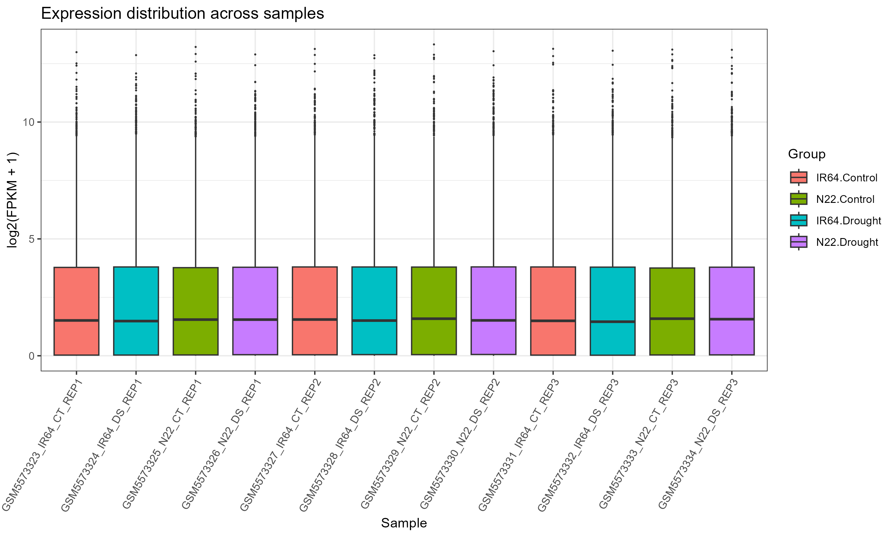
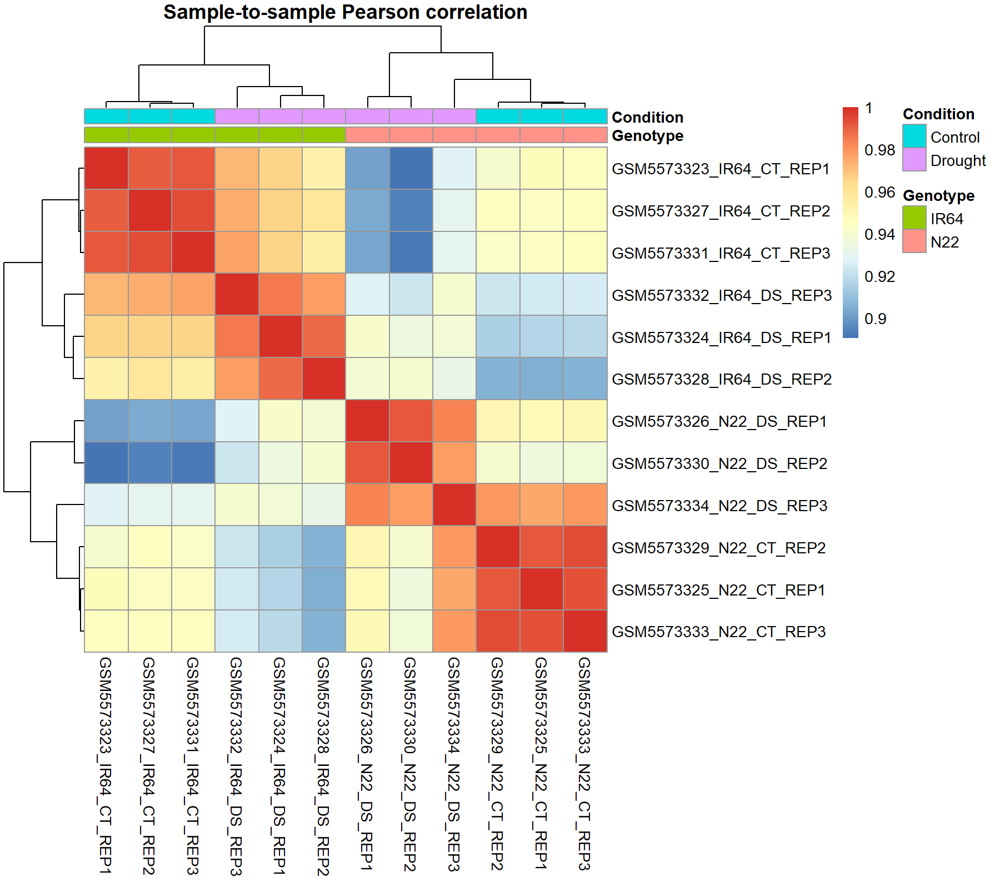
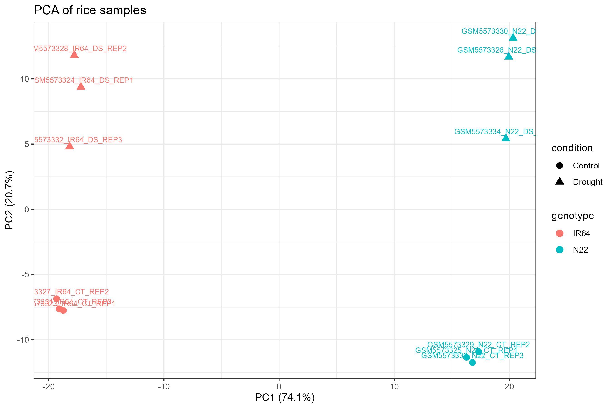
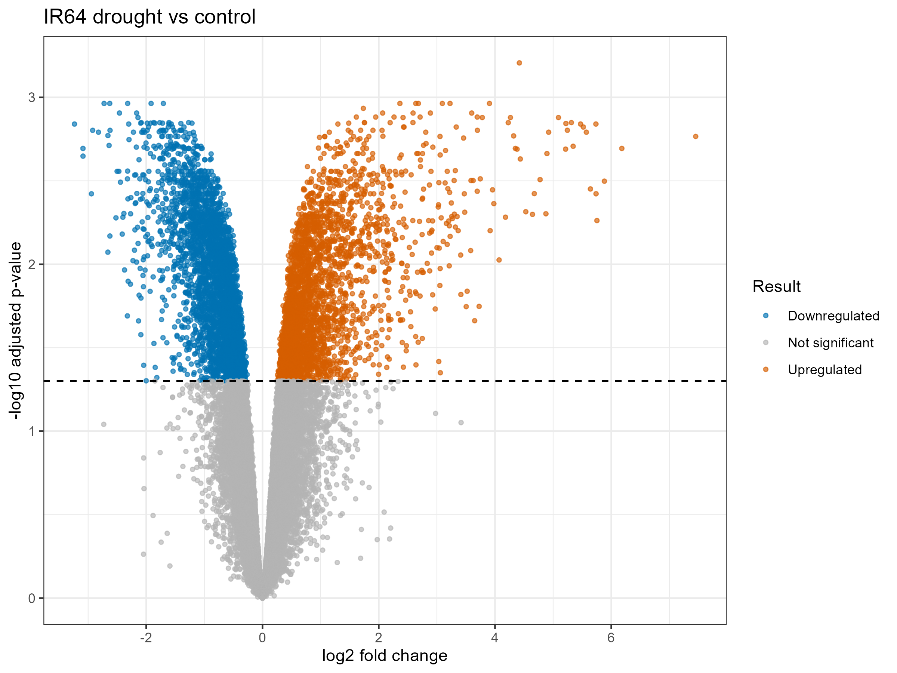
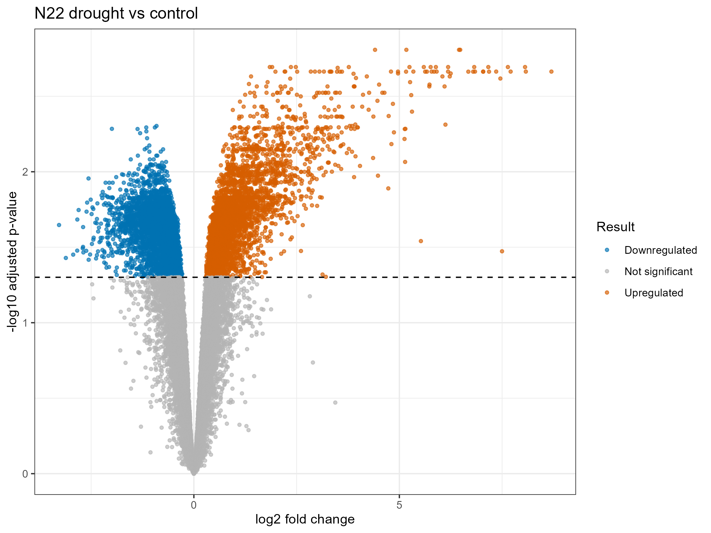
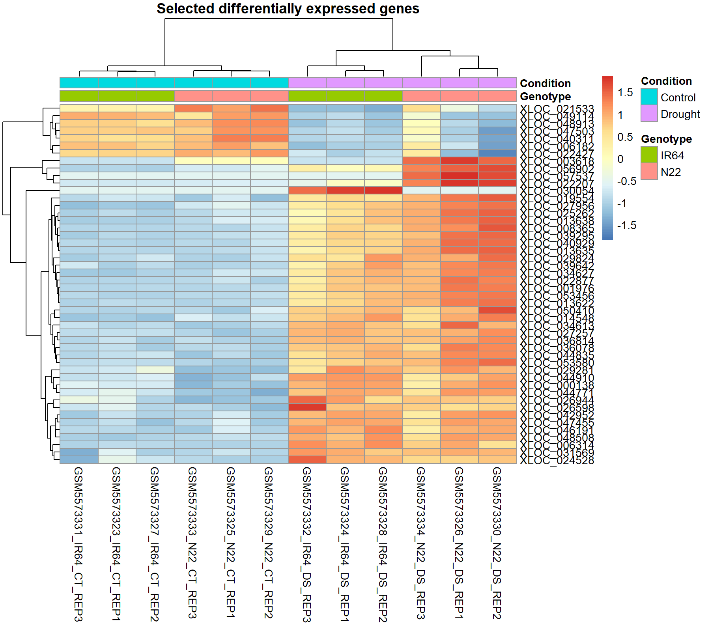

# Differential Gene Expression Analysis of Crop Drought Stress Response

**Coursework:** Bioinformatics  
**Author:** Yathees Thiraviyarajah  
**Student ID:** 2021/ASP/33  
**Organism:** *Oryza sativa* (rice)  
**GEO accession:** [GSE183894](https://www.ncbi.nlm.nih.gov/geo/query/acc.cgi?acc=GSE183894)  
**Analysis environment:** R 4.3.2; Windows 11  
**Main statistical package:** `limma`

---

## Abstract

Drought stress can alter crop growth and gene expression. This project analyses public rice (*Oryza sativa*) data from GEO series GSE183894, comparing drought-simulation and control samples from IR64 and N22. Twelve FPKM files were combined into a gene-by-sample matrix, followed by quality assessment, PCA, correlation analysis and differential expression modelling. Since the data are processed FPKM values rather than raw counts, the analysis uses log2(FPKM + 1) and `limma`, not DESeq2 or `voom`. The union matrix contains 39,718 genes. Separate comparisons tested 23,019 genes in IR64 and 23,316 in N22. At adjusted p-value < 0.05, 6,157 genes were significant in IR64 and 7,520 in N22. These results are candidate expression changes, not proof that any gene causes drought tolerance.

## 1. Introduction

Water limitation affects plant growth and can alter genes involved in signalling, metabolism and stress responses. Rice is an important crop for studying these processes. The selected GEO study describes IR64 as drought-sensitive and N22 as drought-tolerant. Comparing drought-simulation and control samples within each cultivar allows their expression responses to be examined.

**Research question:** Which genes show evidence of differential expression between drought-treated and control rice seedlings in IR64 and N22?

**Aim:** To analyse public rice gene-expression data and identify candidate genes whose expression differs between drought-simulation and control conditions in the two cultivars.

**Objectives:**

1. Obtain and document the public GSE183894 expression dataset.
2. Inspect the supplied sample files and construct a consistent gene-expression matrix.
3. Check sample distributions, correlations and major expression patterns using exploratory visualisations.
4. Apply `limma` to log-transformed FPKM values for separate drought-versus-control comparisons in IR64 and N22.
5. Summarise and visualise the differential-expression results and discuss their limitations.

## 2. Dataset and experimental design

The data are from NCBI GEO series [GSE183894](https://www.ncbi.nlm.nih.gov/geo/query/acc.cgi?acc=GSE183894), profiling IR64 and N22 rice cultivars. GEO sample descriptions indicate that 21-day-old seedlings were exposed for six hours to reverse-osmosis water (control) or 20% PEG 6000 (drought-simulation treatment). PEG imposes osmotic stress but does not reproduce every feature of field drought.

The supplied project includes 12 compressed tab-delimited files (`.txt.gz`). The experimental design is balanced, with three biological replicates for each cultivar-condition combination:

| Cultivar | Control | Drought simulation | Total |
|---|---:|---:|---:|
| IR64 | 3 | 3 | 6 |
| N22 | 3 | 3 | 6 |
| **Total** | **6** | **6** | **12** |

The files are stored in `data/raw/`. Sample identifiers and group labels are parsed from filenames and recorded in `data/processed/sample_metadata.csv`. The preparation summary records 12 original files and 12 retained samples. The combined matrix contains 39,718 unique gene identifiers in the union across the sample files. The preprocessing summary reports 13,988 genes with at least one zero after the union and no negative expression values.

### Data type and analytical implications

The supplied values are FPKM, normalised for transcript length and sequencing depth, not raw read counts. The workflow therefore uses `log2(FPKM + 1)` and `limma`; DESeq2 and `voom` are not applied. FPKM has limitations for between-sample comparison, so these results analyse the supplied processed matrix and do not replace a raw-count analysis.

## 3. Methods

### 3.1 Software and packages

The project was run using R 4.3.2 on Windows 11. The main packages include `tidyverse` for data import and manipulation, `ggplot2` for visualisation, `pheatmap` for heatmaps, and Bioconductor's `limma` package for differential expression. `GEOquery` is included for optional retrieval of supplementary GEO files, although the original 12 files are already supplied in `data/raw/` and do not need to be downloaded again.

### 3.2 Preprocessing

The preprocessing script reads the compressed `.txt.gz` files directly. It checks that exactly 12 FPKM files are available and parses each filename to determine the GEO sample accession, cultivar, condition and replicate. Gene expression values are combined by gene identifier to form a matrix with genes as rows and samples as columns. Gene short names are stored separately in `data/processed/gene_annotation.csv`. The resulting matrix and metadata are saved in both CSV and RDS formats so that they can be inspected and reused by later scripts.

The processing summary indicates 12 input files and 12 samples. The union matrix contains 39,718 genes. A zero in the union matrix indicates that the corresponding gene has a zero expression value in at least one sample; it does not mean that the gene is absent from every sample. No negative expression values were reported. The project preserves the original compressed files and writes derived data to `data/processed/`.

### 3.3 Exploratory analysis and quality assessment

Expression values were transformed using `log2(FPKM + 1)`. Boxplots, density plots, a Pearson correlation heatmap and PCA based on up to 500 variable genes were generated. In the supplied PCA, PC1 explains 74.1% and PC2 20.7% of variance. Cultivars separate mainly along PC1, while treatment patterns are visible along PC2. Replicates generally cluster by cultivar and condition in the correlation heatmap. These are descriptive checks, not grounds for removing samples without independent evidence.

### 3.4 Differential expression analysis

Differential expression was tested separately for each cultivar. For each comparison, the model contrasts drought-simulation samples against control samples:

- **IR64:** Drought − Control.
- **N22:** Drought − Control.

Genes with expression greater than 1 FPKM in at least two samples within the relevant cultivar were retained for that cultivar's model. The transformed expression matrix was fitted using `limma::lmFit`. A contrast matrix defined Drought minus Control, and empirical Bayes moderation was applied using `eBayes` with trend and robust options. P-values were adjusted for multiple testing using the Benjamini–Hochberg procedure. Genes with adjusted p-value (FDR) below 0.05 were classified as statistically significant. A positive log-fold change indicates higher expression under drought simulation; a negative value indicates lower expression under drought simulation. The analysis reports effect sizes and adjusted p-values rather than relying on p-values alone.

These are two separate within-cultivar comparisons. They do **not** constitute a formal test of whether the drought response differs between IR64 and N22. A genotype-by-treatment interaction model would be required to test that question directly.

## 4. Results

### 4.1 Preprocessing summary

| Metric | Result |
|---|---:|
| Original FPKM files | 12 |
| Samples retained | 12 |
| Genes in union matrix | 39,718 |
| Genes with at least one zero across samples | 13,988 |
| Negative expression values | 0 |

All 12 supplied sample files were represented in the metadata, with three replicates in each of the four cultivar-condition groups. The gene union matrix includes any gene identifier found in at least one sample file. The differential-expression analysis applies an additional within-cultivar expression filter, so the number of genes tested is smaller than the 39,718-gene union matrix.

### 4.2 Exploratory results

The PCA plot indicates a strong cultivar-associated pattern on PC1 (74.1% of variance) and a treatment-associated pattern on PC2 (20.7%). This suggests that cultivar identity accounts for a substantial component of variation in the expression matrix, while treatment also contributes to the observed sample structure. The sample-correlation heatmap shows grouping of biological replicates by cultivar and condition. The boxplot and density plot provide complementary checks of sample expression distributions. These exploratory observations are descriptive and should not be interpreted as proof of a biological mechanism.



*Figure 1. Distribution of log2(FPKM + 1) expression values across the 12 samples.*



*Figure 2. Pearson correlation between samples, with cultivar and condition annotations.*



*Figure 3. PCA of the rice expression profiles. PC1 explains 74.1% and PC2 explains 20.7% of the variance shown.*

### 4.3 Differential expression results

The supplied `limma` output contains the following summary:

| Cultivar | Genes tested | Significant (FDR < 0.05) | Upregulated | Downregulated |
|---|---:|---:|---:|---:|
| IR64 | 23,019 | 6,157 | 2,802 | 3,355 |
| N22 | 23,316 | 7,520 | 3,810 | 3,710 |

The analysis identified 6,157 significant genes in IR64 and 7,520 in N22 at the selected FDR threshold. In IR64, 2,802 significant genes had positive log-fold changes and 3,355 had negative log-fold changes. In N22, 3,810 were upregulated and 3,710 were downregulated. The greater number of significant genes in N22 is an observation from these analyses; it should not, by itself, be interpreted as proof that N22 is more drought tolerant or that it has a stronger biological response. Differences in expression variability, sample size, effect sizes and statistical power can influence the number of discoveries.

The top candidates below are selected by adjusted p-value within each direction. Gene identifiers are shown alongside the short-name annotation supplied with the dataset. The XLOC identifier is retained because it is the identifier used in the expression matrix. An annotation is not a functional validation.

**IR64 – strongest significant candidates by adjusted p-value**

| Direction | Gene ID | Supplied short-name annotation | logFC | Adjusted p-value |
|---|---|---|---:|---:|
| Up | XLOC_027257 | LOC_Os03g02050 | 4.419 | 0.000621 |
| Up | XLOC_006314 | LOC_Os01g68290 | 3.905 | 0.001088 |
| Up | XLOC_034613 | LOC_Os04g42950 | 2.636 | 0.001088 |
| Down | XLOC_047503 | LOC_Os07g49310 | -2.629 | 0.001088 |
| Down | XLOC_006182 | LOC_Os01g65690 | -2.725 | 0.001088 |
| Down | XLOC_021533 | LOC_Os02g58720 | -1.916 | 0.001088 |

**N22 – strongest significant candidates by adjusted p-value**

| Direction | Gene ID | Supplied short-name annotation | logFC | Adjusted p-value |
|---|---|---|---:|---:|
| Up | XLOC_031569 | LOC_Os04g33920 | 4.408 | 0.001557 |
| Up | XLOC_057537 | Not supplied | 6.480 | 0.001557 |
| Up | XLOC_053456 | LOC_Os08g34390 | 6.452 | 0.001557 |
| Down | XLOC_007931 | LOC_Os10g30070 | -0.909 | 0.004972 |
| Down | XLOC_044305 | LOC_Os06g35940 | -1.159 | 0.005088 |
| Down | XLOC_033494 | LOC_Os04g17479 | -0.949 | 0.005088 |



*Figure 4. IR64 drought-versus-control differential-expression results. The vertical axis represents the negative log10 adjusted p-value and the horizontal axis represents log-fold change.*



*Figure 5. N22 drought-versus-control differential-expression results.*



*Figure 6. Expression patterns of selected differentially expressed genes across all 12 samples. Values are row-scaled for visual comparison.*

The complete statistical tables, including logFC, average expression, moderated t-statistic, raw p-value, adjusted p-value and B statistic, are available in `output/limma_IR64.csv` and `output/limma_N22.csv`. The complete significant-gene lists should be used for any follow-up gene annotation or enrichment analysis.

## 5. Discussion

The analysis indicates that drought-simulation treatment is associated with substantial gene-expression differences in both rice cultivars. Thousands of genes passed the selected FDR threshold in each within-cultivar comparison. Both positive and negative log-fold changes were observed, showing that the treatment-associated expression pattern includes genes with increased and decreased expression. The PCA and correlation plots also show that cultivar identity and treatment condition are reflected in the overall expression structure.

A number of genes appear among the strongest candidates in the separate analyses. For example, XLOC_027257, annotated in the supplied file as LOC_Os03g02050, is upregulated in both IR64 and N22. This overlap is a useful observation for further investigation, but it does not establish the gene's role in drought response. The XLOC identifiers and short-name annotations should be checked against current rice genome annotation resources before assigning biological functions. Functional claims should be supported by annotation records and relevant peer-reviewed literature, not inferred from fold change alone.

The N22 comparison produced more FDR-significant genes than the IR64 comparison. This difference is worth reporting but must be interpreted cautiously. The two separate analyses do not test the difference between cultivar responses. To establish whether the treatment effect differs statistically between IR64 and N22, a combined model containing genotype, treatment and their interaction should be fitted. The small number of biological replicates (three per group) also limits precision and may affect statistical power.

Limitations include the use of FPKM rather than raw counts, PEG treatment as an imperfect simulation of field drought, and only three biological replicates per group. The analysis identifies associations, not causal mechanisms or validated drought-tolerance genes. Gene annotations should be verified before functional claims, and enrichment analysis is a possible follow-up.

## 6. Conclusion

This project provides a reproducible workflow for examining rice gene-expression responses to drought-simulation treatment using the public GSE183894 dataset. Twelve sample files were combined into a 39,718-gene union expression matrix. Exploratory plots showed clear cultivar-associated structure and treatment-associated patterns. Separate `limma` analyses identified 6,157 FDR-significant genes in IR64 and 7,520 in N22. The results provide a set of candidate genes for further annotation and functional investigation. They should not be interpreted as proof that individual genes cause drought tolerance or that one cultivar has a statistically stronger response. Future work should validate candidate genes, examine functional enrichment, and use an interaction model or raw-count analysis where suitable data are available.

## 7. Reproducibility and project structure

The project is organised as follows:

```text
Crop_Drought_Gene_Expression/
├── README.md
├── Crop_Drought_Gene_Expression.Rproj
├── code/
│   ├── 00_install_packages.R
│   ├── 01_download_geo_data.R
│   ├── 02_prepare_expression.R
│   ├── 03_exploratory_analysis.R
│   ├── 04_differential_expression_limma.R
│   ├── 05_session_info.R
│   ├── 06_render_report.R
│   ├── Project_Report.Rmd
│   └── run_all.R
├── data/
│   ├── raw/
│   └── processed/
├── figures/
└── output/
```

To reproduce the analysis:

1. Install R and RStudio.
2. Extract the repository and open `ICA3_Crop_Drought_Gene_Expression.Rproj` from the project root.
3. Run `source("code/00_install_packages.R")` once to install required packages.
4. The 12 original compressed FPKM files are already supplied in `data/raw/`; the optional GEO download script is not required for the included data.
5. Run `source("code/run_all.R")` from the project root. The pipeline prepares the matrix, creates exploratory figures, performs both `limma` contrasts, records session information and renders the report.
6. Review the generated files in `data/processed/`, `figures/` and `output/`.

The supplied analysis outputs were generated using R 4.3.2 on Windows 11. The recorded session information is in `output/sessionInfo.txt`. Package versions can change over time, so exact numerical reproducibility may require the same R and package versions. The raw compressed files should remain unchanged. All derived data and figures can be regenerated by running the scripts.

## 8. References

1. NCBI Gene Expression Omnibus. **GSE183894: Gene expression profiling of drought-sensitive (IR64) and tolerant (N22) rice cultivars.** [https://www.ncbi.nlm.nih.gov/geo/query/acc.cgi?acc=GSE183894](https://www.ncbi.nlm.nih.gov/geo/query/acc.cgi?acc=GSE183894).
2. NCBI Gene Expression Omnibus. **GSM5573328 sample record.** [https://www.ncbi.nlm.nih.gov/geo/query/acc.cgi?acc=GSM5573328](https://www.ncbi.nlm.nih.gov/geo/query/acc.cgi?acc=GSM5573328).
3. Ritchie, M. E., Phipson, B., Wu, D., Hu, Y., Law, C. W., Shi, W., & Smyth, G. K. (2015). limma powers differential expression analyses for RNA-sequencing and microarray studies. *Nucleic Acids Research, 43*(7), e47. [https://doi.org/10.1093/nar/gkv007](https://doi.org/10.1093/nar/gkv007).
4. Smyth, G. K. (2004). Linear models and empirical Bayes methods for assessing differential expression in microarray experiments. *Statistical Applications in Genetics and Molecular Biology, 3*(1). [https://doi.org/10.2202/1544-6115.1027](https://doi.org/10.2202/1544-6115.1027).
5. Bioconductor. **GEOquery: Get data from NCBI Gene Expression Omnibus (GEO).** [https://bioconductor.org/packages/GEOquery/](https://bioconductor.org/packages/GEOquery/).
6. Bioconductor. **limma: Linear Models for Microarray and Omics Data.** [https://bioconductor.org/packages/limma/](https://bioconductor.org/packages/limma/).
